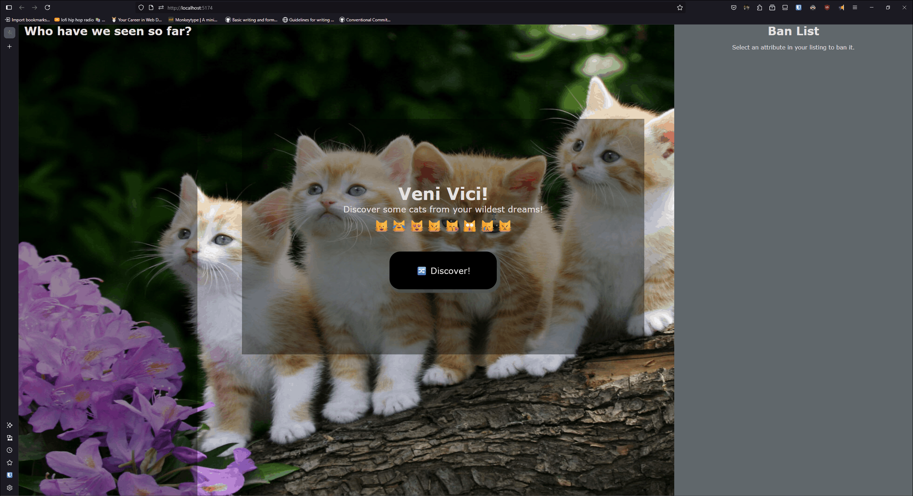

# Web Development Project 4 - _Cat Image Generator_

Submitted by: **Sebastián L. Corporán Berríos**

This web app: **uses the [Cat API](https://thecatapi.com/) to generate random images. This web app also displays the images along with the descriptions of the cats that have been generated. Also, it lets the user ban an attribute. When the user clicks on one of the attributes displayed, that attribute is displayed in the ban list. If the user clicks on one of the attributes of the ban list, that attribute is unbanned.**

Time spent: **25** hours spent in total

## Required Features

The following **required** functionality is completed:

-   [x] **Application features a button that creates a new API fetch request on click and displays at least three attributes and an image obtained from the returned JSON data**
    -   The type of attribute displayed for each image should be consistent across API calls (i.e. if you are using a cat API, and display the color, breed, and age in response to an initial API call, subsequent button clicks should also result in the color, breed, and age being displayed)
-   [x] **Only one item/data from API call response is viewable at a time and at least one image is displayed per API call**
    -   A single result of an API call is displayed at a time
    -   Displayed attributes should match the displayed image (i.e., if showing a picture of a Siamese cat and the attribute breed, the displayed breed should be 'Siamese' not 'Ragdoll' or another breed that doesn't match)
    -   There is at least one image per API call
-   [x] **API call response results should appear random to the user**
    -   Clicking on the API call button should generate a seemingly random new result each time
    -   Note: Repeat results are permitted but the API used should have a reasonably large amount of data and repeats should not be frequent
-   [x] **Clicking on a displayed value for one attribute adds it to a displayed ban **list\*\*
    -   At least one attribute for each API result should be clickable
    -   Clicking on a clickable attribute not on the ban list, should immediately add it to the ban list
    -   Clicking on an attribute in the ban list should immediately remove it from the ban list
-   [x] **Attributes on the ban list prevent further images/API results with that attribute from being displayed**
    -   Clicking on the API call button should not result in any image/attributes with attribute values in the ban list being displayed (ex. Using a cat API, if the ban list includes the value 'Siberian' for the breed attribute, clicking on the Discover button should never result in a Siberian cat being displayed)
    -   Note: More attribute values on the ban list may result in a higher frequency of repeat results
    -   [x] _To ensure an accurate grade, your recording **must** show that when clicked, an attribute in the ban list is immediately removed from the list of banned attributes_

The following **optional** features are implemented:

-   [x] Multiple types of attributes are clickable and can be added to the ban list
-   [x] Users can see a stored history of their previously displayed results from this session
    -   A dedicated section of the application displays all the previous images/attributes seen before
    -   Each time the API call button is clicked, the history updates with the newest API result

The following **additional** features are implemented:

-   [x] Prevent the user from clicking an attribute that is already banned. If the user tries to do this, a alert box is displayed.
-   [x] Add a scrollbar to the sidebar that displays the history of generated cats. This scrollbar is displayed when there is an overflow.

## Video Walkthrough

Here's a walkthrough of implemented user stories:

<!-- Replace this with whatever GIF tool you used! -->

GIF created with [ScreenToGif](https://www.screentogif.com/) for Windows

<!-- Recommended tools:
[Kap](https://getkap.co/) for macOS
[peek](https://github.com/phw/peek) for Linux. -->

## Notes

The challenges that I encountered building the app were the following:

-   **Learning APIs and Asynchronous JavaScript**: I sound like a broken record at this point, because I mention this in every project, but I've never had the ability to learn things quickly. In order to learn both topics, I had to dedicate a bit of time before starting the project. What really helped me learn APIs was to go through [The Odin Project's](https://www.theodinproject.com/) [JavaScript Course](https://www.theodinproject.com/paths/full-stack-javascript/courses/javascript), in particular, the section titled "Asynchronous JavaScript".

-   **Removing attributes from "BanList" component**: At first, I tried using the Array.splice() method, but it never worked. In the [React Developer Tools](https://react.dev/learn/react-developer-tools), I could see that after clicking the same attribute a few times, it was removed. For this, I had an "index" state variable, and after removing the value, I decreased the index by one. When I ran out of ideas with the splice method, I prompted Copilot to see what the issue was, and it recommended me to use the Array.filter() method. And turns out that using the Array.filter() method was way to solve this problem.

## License

    Copyright [2025] [Sebastián L. Corporán Berríos]

    Licensed under the Apache License, Version 2.0 (the "License");
    you may not use this file except in compliance with the License.
    You may obtain a copy of the License at

        http://www.apache.org/licenses/LICENSE-2.0

    Unless required by applicable law or agreed to in writing, software
    distributed under the License is distributed on an "AS IS" BASIS,
    WITHOUT WARRANTIES OR CONDITIONS OF ANY KIND, either express or implied.
    See the License for the specific language governing permissions and
    limitations under the License.
